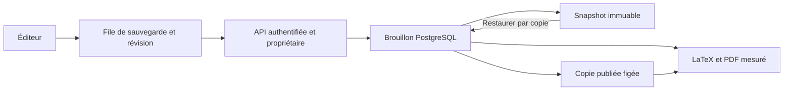

# Rapport d'ingénierie — CV Builder

Rapport initial du 17 octobre 2026, complété le 18 octobre. Vercel reste la cible de production. Aucune migration de production n'a été exécutée depuis cette session.

**État actuel demandé par le propriétaire : compatibilité avec le déploiement d'origine.** Le repli vers `NEXT_PUBLIC_SUPABASE_PUBLISHABLE_DEFAULT_KEY` est restauré, et la compilation ne dépend plus d'un contrôle Supabase. La base distante a été reconnue en lecture seule comme un schéma d'origine : les requêtes demandaient zéro ligne. Le serveur s'adapte sans imposer de clé ni de migration supplémentaires. Les garanties de permissions/RPC décrites ci-dessous concernent le mode migré optionnel ; le mode compatible conserve les permissions existantes, des quotas locaux par instance et des opérations multi-requêtes plutôt que les transactions complètes du mode migré. Voir [VERCEL.md](../VERCEL.md).

## A. Synthèse

Les corrections couvrent la sécurité des données, les sessions, les sauvegardes concurrentes, l'historique, les photos, le partage, l'IA et les seize modèles LaTeX. Le contenu validé constitue une source commune pour l'éditeur, les versions, l'IA et les exports. Les modifications sont implémentées, avec des tests exécutables et une procédure de déploiement coordonnée.

L'IA réelle OpenRouter a été vérifiée avec la configuration existante et des CV fictifs : analyse, adaptation et condensation renvoient des réponses structurées. Un parcours navigateur réel vérifie aussi application d'une suggestion, persistance et annulation. Les modèles disposent de structures distinctes, de six palettes supplémentaires et de deux familles typographiques personnalisables.

La certification du Supabase et du runtime Vercel déployés nécessite encore les contrôles décrits en H. Un résultat local vert ne constitue pas une affirmation de fiabilité absolue en production.

## B. Constats vérifiés et corrections

| Constat et cause | Fichiers principaux | Correction | Preuve |
| --- | --- | --- | --- |
| Le module IA initial contenait deux implémentations concaténées et des erreurs de syntaxe | `lib/ai/cv-review.ts` | Conservation de l'implémentation cohérente, suppression du bloc dupliqué et des imports invalides | Échec TypeScript initial reproduit ; typecheck final vert |
| Les scripts du dépôt ne protégeaient pas les tables privées par RLS/grants ; le client serveur acceptait une clé publique comme repli | `scripts/003-security-and-drafts.sql`, `lib/db/index.ts` | RLS, révocation des rôles navigateur et client privilégié exclusivement serveur, sans repli public | Tests SQL des rôles et refus des RPC ; le statut du projet Supabase distant reste à contrôler |
| Vérification et consommation des liens de connexion n'étaient pas atomiques | `lib/db/users.ts`, migration 003 | Consommation conditionnelle en une instruction PostgreSQL, hachage des tokens, expiration et invalidation de session | Rejeu, expiration et requêtes concurrentes testés |
| La présence d'un cookie pouvait remplacer la validation de session | `proxy.ts`, routes d'authentification | Session vérifiée, cookie invalide supprimé, redirections internes contrôlées et mutations de même origine | Parcours connexion/expiration/déconnexion et origine hostile |
| Les écritures d'éditeur pouvaient acquitter un état plus récent que la requête réellement sauvegardée | `lib/autosave.ts`, éditeur | File sérialisée, numéro de révision attendu, acquittement de l'édition capturée, reprise et conflit visible | Édition pendant sauvegarde retardée, panne réseau, retry et conflits |
| Le contenu courant réutilisait des lignes d'historique modifiables | migration 003, `lib/db/cvs.ts` | Brouillon distinct, snapshots immuables, restauration par copie et verrouillage de ligne | V1/V2/V3 conservées après restauration, modifications et V4 ; trigger anti-modification |
| Création, V1 et limite Free reposaient sur des opérations séparées | migration 003 | Verrou du propriétaire et transaction unique ; duplication par la même opération | Créations concurrentes, limite Free et cohérence de V1 |
| Les réponses publiques exposaient des métadonnées internes et le partage suivait les modifications privées | routes de partage, `publish_cv` | DTO explicite et copie publiée figée ; révocation avec nouveau token lors de la réactivation | Métadonnées absentes, brouillon privé, JSON/PDF/photos refusés après révocation |
| Des champs du schéma ne disposaient pas d'édition complète | sections Awards/Custom, projets/certifications, `lib/validation/cv.ts` | CRUD, dates/liens et contrat commun dont les types sont dérivés | Édition, sauvegarde, versions et extraction PDF des sections |
| Les photos nécessitaient des contrôles de format, décodeur, taille et persistance cohérente | upload/photo, photos, migration 004 | Signature/MIME, décodage Sharp, 16 mégapixels, limite 4 MiB adaptée à Vercel, fichier référencé et transaction | Fichiers falsifiés, mauvais MIME, pixels excessifs, formulaire invalide, taille et accès public/privé |
| Les aperçus illustrés ne représentaient pas les exports et des générateurs n'étaient pas utilisés | catalogue, générateur, thumbnails | Seize conceptions actives et aperçus WEBP issus du PDF Tectonic réel | Compilation, texte, liens, comparaison raster et hash des sources |
| Le format une page n'était pas garanti par une mesure du résultat | `lib/pdf/render.ts` | Comptage réel, trois densités bornées, corps ≥ 9,5 pt et marges ≥ 12 mm ; erreur explicite ou choix multipage | Seize cas normaux, seize débordements et conservation de la dernière entrée en multipage |
| La configuration OpenRouter existante n'était pas utilisée par l'adaptateur Groq | `lib/ai/provider.ts` | Un adaptateur commun, Groq prioritaire si les deux clés existent, source et secours explicitement identifiés | Contrats simulés des deux fournisseurs et appels OpenRouter réels |
| Nemotron dépassait le délai malgré une clé valide | adaptateur IA | Désactivation du raisonnement prolongé pour les tâches d'édition structurée, délais et réparation JSON bornés | Délais initiaux de 10/25 s reproduits, puis trois actions réelles et parcours navigateur réussis |
| Des suggestions pouvaient réaffecter des compétences ou modifier/omettre des métriques | `lib/ai/grounding.ts`, `lib/keywords.ts` | Vocabulaire partagé, comparaison de métriques entières, preuves par emploi, IDs/rôles exacts, ordre et nombre de puces conservés | Tests de métriques, compétences non prouvées et suggestions rejetées ; revue humaine toujours requise |
| Les fonctions PDF pouvaient omettre le worker dynamique et embarquer d'anciens documents temporaires | `next.config.mjs`, vérification des bundles | Inclusion des workers/runtime/cache ; exclusion des PDF, sorties QA, tests et fichiers temporaires | Vérification des traces privées/publiques, absence de fichiers `.env` et documents |
| Une compilation Tectonic à froid téléchargeait trop de ressources ; un timeout Windows pouvait masquer l'erreur par EBUSY | compilateur et préparation du cache | Préparation des packages/polices pendant la build, copie vers `/tmp`, compilation hors ligne ; attente de fermeture native avant nettoyage | Cache réel des seize modèles/deux polices/photo et contrôles Tectonic |
| XeTeX pouvait produire un PDF valide en omettant un caractère absent de la police | `lib/pdf/compiler.ts` | Détection des avertissements de glyphes manquants et erreur 422 explicite | Omission d'un caractère reproduite, puis refus testé sur les deux moteurs |

Améliorations préventives distinctes des anomalies reproduites : quotas PostgreSQL partagés entre instances, validation de taille des flux, réduction des DTO, diagnostic sans contenus privés, mise à jour des dépendances, configuration serveur Supabase utilisable à l'exécution et CI. Aucune exposition de données du Supabase déployé n'est affirmée sans inspection de ses politiques effectives.

## C. Architecture

Le contenu, le titre et le modèle traversent la même file de sauvegarde. Les préférences de style appartiennent au contenu et suivent automatiquement versions, restauration, partage et exports. Le téléchargement PDF attend les sauvegardes et exige la bonne révision serveur ; l'aperçu compile le contenu local avec les mêmes règles. Une réponse devenue obsolète ne remplace pas un aperçu plus récent.

La compilation utilise des répertoires temporaires uniques, aucun shell escape, des logs bornés, un temps limité et un cache de résultats de petite taille. Les ressources LaTeX préparées sont distinctes des documents utilisateur. Le cache de paquets peut être empaqueté ; les PDF temporaires ne le peuvent pas.

## D. Base de données et déploiement

- Prérequis : migrations 001 et 002, sauvegarde et environnement de staging.
- Migration 003 : brouillon/révision/contenu publié, conservation de l'existant, tokens hachés, RLS/grants, quotas et transactions atomiques de création/sauvegarde/version/restauration/publication.
- Migration 004 : fichier photo et référence CV/profil sauvegardés dans une transaction.
- Contrôle privilégié en lecture seule : `scripts/verify-security.sql`. Contrôles applicatifs : `pnpm db:check` et `pnpm db:check:public`.
- Coordiner migration et déploiement ; les anciennes versions de l'application ne doivent plus écrire après migration. Un retour du seul code vers l'ancien système est dangereux pour l'historique et les tokens. Préférer une correction en avant ou une restauration coordonnée des sauvegardes en réconciliant les modifications ultérieures.

Le test distant avec la clé publique a effectué uniquement des sélections `LIMIT 0`, sans récupérer de données privées : neuf tables ont répondu sans refus SQL explicite, ce qui est **inconclusif** quant à la protection par RLS. `rate_limits` a renvoyé `PGRST205` (absente ou non exposée). Ce contrôle n'a donc pas été déclaré réussi et ne remplace pas la vérification SQL.

Les clés déjà configurées dans Vercel ne sont pas modifiées. Le client serveur accepte l'URL privée optionnelle `SUPABASE_URL`, puis l'URL publique existante ; la clé de service demeure obligatoire. Voir [la procédure de déploiement](../VERCEL.md) et [la reprise détaillée](hardening-deployment.md).

## E. IA

Le fournisseur reçoit le contenu professionnel utile, sans photo ni bloc de coordonnées personnelles. Les réponses sont validées par Zod, avec une seule réparation structurelle, des tentatives HTTP limitées et un budget de temps global. Les erreurs exposées sont rédigées par l'application ; les contenus/diagnostics bruts du fournisseur ne sont pas journalisés.

Le contrôle CLI réel a mesuré environ 14,6 s pour l'analyse, 11,0 s pour l'adaptation avec deux réécritures acceptées, et 3,5 s pour la condensation. Un repli intermittent a aussi été observé pendant les essais navigateur : les erreurs transitoires et timeouts sont désormais repris une fois dans le budget global, sans prolongation illimitée. Le dernier parcours navigateur réel a réussi les trois actions, application, sauvegarde et annulation. Ces mesures ponctuelles ne constituent pas un engagement de latence du fournisseur.

Les compétences proposées doivent être présentes dans les preuves du candidat. Les réécritures doivent référencer le bon emploi et conserver ses métriques, son nombre de puces et leur ordre. Les propositions rejetées restent exclues et sont signalées. La condensation ne remplace pas automatiquement le contenu. Application sélective, sauvegarde et annulation ont été testées ; l'annulation conserve les éditions manuelles faites après la proposition.

Les scores restent des estimations de contenu, non une certification ATS ou une probabilité d'embauche. Le secours déterministe est étiqueté et ne fabrique pas d'expérience. Les filtres ne constituent pas une preuve sémantique exhaustive : la comparaison humaine des formulations reste nécessaire. Les permissions Pro sont vérifiées par le serveur ; le contact `dhiaayed03@gmail.com` n'accorde aucun abonnement et aucun faux paiement n'est ajouté.

## F. Modèles et PDF

Moteur canonique des aperçus : Tectonic 0.16.9, même version officielle sur Windows pour ces vérifications et Linux pour Vercel. Les archives sont vérifiées par SHA-256. Le cache de build compile chaque modèle avec les deux familles typographiques et une photo ; les fonctions utilisent ensuite les ressources préparées hors ligne.

| Modèle | Structure dominante | PDF de référence | Densité retenue | Aperçu |
| --- | --- | --- | --- | --- |
| Modern | Colonne unique, titres contemporains et filets | 1 page | compact | PDF réel |
| Classic | En-tête centré, serif et petites capitales | 1 page | compact | PDF réel |
| Minimal | Hiérarchie sobre sans décoration superflue | 1 page | dense | PDF réel |
| Compact | En-tête large et espacement efficace | 1 page | normal | PDF réel |
| Professional | Composition professionnelle centrée, sections structurées | 1 page | dense | PDF réel |
| Executive | Grand masthead serif à double filet | 1 page | dense | PDF réel |
| Banking | Identité à gauche, coordonnées à droite, hiérarchie conservatrice | 1 page | compact | PDF réel |
| Elegant | Composition serif raffinée avec colonne latérale | 1 page | normal | PDF réel |
| Creative | Composition asymétrique sans serif et marqueurs | 1 page | compact | PDF réel |
| Fancy | En-tête encadré, petites capitales et accent décoratif | 1 page | compact | PDF réel |
| Bold | Bandeau contrasté et forte hiérarchie typographique | 1 page | compact | PDF réel |
| Infographic | Groupes d'information sur deux colonnes et bandeau | 1 page | normal | PDF réel |
| Tech | Compétences/projets en premier, signature monospace | 1 page | normal | PDF réel |
| Academic | Formation et réalisations académiques en premier | 1 page | dense | PDF réel |
| Casual | En-tête centré, sans serif et titres sobres | 1 page | dense | PDF réel |
| Vintage | Masthead traditionnel et petites capitales serif | 1 page | dense | PDF réel |

Chaque cas normal comporte expérience, formation, compétences, projets, certifications, récompenses, langues et section personnalisée, avec accents et liens. Les exemples excessifs sont refusés en une page, sans troncature. L'export multipage est explicite. Les modèles à plusieurs colonnes portent un avertissement sur l'ordre de lecture ATS.

Les six palettes supplémentaires et les choix serif/sans serif sont indépendants du modèle. La source `.tex` utilise la densité compilée ; avec une photo, elle référence le fichier auxiliaire `cv_photo.png`. L'export JSON embarque la photo pour sa portabilité. Un `.tex` brut avec photo n'est pas présenté comme une archive autonome complète.

## G. Résultats exécutés

Exécutions locales sous Windows x64, Node.js 23.8.0, pnpm 10.13.1 et Python 3.13.3. La CI et les instructions Vercel ciblent Node.js 22. La [CI Linux du commit `556f4e6`](https://github.com/dhiaxayed/CV-builder/actions/runs/39071405882) a terminé avec succès sur GitHub ; cela ne valide pas la configuration Supabase du compte Vercel.

Vérification complémentaire du 18 octobre 2026 avec Node.js 22.23.3, téléchargé depuis nodejs.org et vérifié par SHA-256 : installation avec lockfile figé réussie, `pnpm ignored-builds` indique `None`, types/lint/23 tests/build et contrôle des bundles réussis. Le parcours `next start` avec authentification, PDF natif, source et révocation réussit également (1/1). `engines.node` est fixé à `22.x` et seuls les scripts d'installation d'`esbuild` et d'`unrs-resolver` sont autorisés. La [CI Linux du correctif Supabase `9dc89e3`](https://github.com/dhiaxayed/CV-builder/actions/runs/39086054388) a aussi réussi ; le déploiement Vercel correspondant est en échec et la clé serveur reste absente de l'environnement local fourni.

| Commande / contrôle | Résultat observé |
| --- | --- |
| `pnpm typecheck` | Réussi |
| `pnpm lint --max-warnings 0` | Réussi, aucune erreur ni warning |
| `pnpm test` | 17 tests unitaires + 8 tests PostgreSQL réussis, dont le repli public d'origine, les clés serveur et la migration optionnelle des données de compatibilité |
| `pnpm test:pdf` avec Tectonic | 37/37 réussis : rendu, aperçus, overflow, images, palette, caractères et multipage |
| `pnpm exec tsx --test tests/pdf/*.test.ts` avec `LATEX_RENDERER=system` | 37/37 réussis ; la comparaison raster des aperçus est réservée à Tectonic |
| `pnpm exec tsx --test --test-name-pattern='published thumbnails' tests/pdf/render.test.ts` | Réussi après la régénération finale et la normalisation des fins de ligne Windows/Linux |
| `python scripts/check-pdf-layout.py` | 16 PDF Tectonic, 1 page chacun, aucun caractère hors page, 5 liens actifs par exemple |
| `python scripts/check-pdf-layout.py output/pdf/system-templates` | Même contrôle géométrique réussi pour les 16 PDF système |
| `pnpm pdf:prepare` | 96 compilations de préparation réussies : 16 modèles × 2 familles × 3 densités, avec photo |
| `pnpm templates:generate` | 16 aperçus issus des PDF réels, texte vérifié et manifest régénéré |
| `pnpm build` | Build optimisée Next.js 16.4.2 réussie, y compris avec `VERCEL=1`, `VERCEL_ENV=production` et la configuration publique existante sans clé serveur |
| `pnpm check:bundles` | Deux fonctions vérifiées, environ 147,7 Mio de traces chacune ; workers présents, aucun PDF, dossier QA ou fichier `.env` embarqué |
| `pnpm test:production` | Parcours applicable réussi en mode clé serveur sur `next start` : cookie Secure/HttpOnly/SameSite, PDF natif, source cohérente et révocation |
| `pnpm test:production:legacy` | 2/2 réussis sans migrations ni clé serveur : anciennes sessions/CV, sauvegarde, partage figé, historique/restauration et PDF natifs privés/publics |
| `pnpm test:e2e` | 14/14 réussis en mode migré et 14/14 en mode d'origine avec uniquement une clé publique : authentification, mobile, style, sauvegardes, versions, droits applicatifs, photos et partage |
| `pnpm test:ai:live` | 3 actions OpenRouter réelles, contrats validés et réécritures factuelles filtrées |
| `pnpm test:e2e:ai:live` | 1/1 réussi avec le fournisseur réel : analyse, condensation, application/sauvegarde/annulation et adaptation Pro |
| `pnpm audit --prod --json` | 0 vulnérabilité connue dans les dépendances de production |
| `git -c core.safecrlf=false diff --check` | Réussi |
| Scan des secrets disponibles dans les 21 chunks client | Aucune valeur OpenRouter/SMTP trouvée ; aucun secret affiché pendant le contrôle |
| `pnpm db:check:public` | Non concluant, code de sortie 1 ; voir D. Aucun enregistrement privé récupéré |
| `pnpm db:check` après retour de compatibilité | Réussi avec l'environnement existant, ancien schéma détecté par requêtes à zéro ligne ; aucune migration appliquée |
| Vérification SMTP via `transporter.verify()` | Connexion et authentification réussies au second essai après un `EDNS` transitoire ; aucun message envoyé |

Le contrôle SMTP vérifie connexion et authentification sans envoyer de message ; il ne prouve pas la délivrabilité ou l'acceptation d'une adresse d'expéditeur. [Documentation Nodemailer](https://nodemailer.com/smtp#verifying-the-configuration).

Les échecs intermédiaires n'ont pas été masqués : syntaxe IA initiale, worker PDF absent, contrôle photo sous le seuil de l'extracteur, téléchargement Tectonic à froid, nettoyage Windows et différences entre moteurs ont été reproduits puis corrigés. Le test de production a également révélé que les variables `NEXT_PUBLIC_*` sont figées à la build : son isolation utilise désormais explicitement l'URL serveur d'exécution. Les tests ne disposent que d'une clé fictive et d'une base locale isolée.

## H. Limites et contrôles externes restants

Avant le push de livraison, ajout d'un contrôle Vercel en lecture seule : colonnes requises et présence des huit RPC via les métadonnées PostgREST. Il bloque la build si les migrations ou l'accès serveur manquent, sans exécuter de SQL ni récupérer de CV. La version actuellement publiée n'est ainsi pas remplacée par cette build incomplète. Ce contrôle ne remplace pas la vérification SQL des permissions ni la recette hébergée.

Ce contrôle automatique a ensuite été retiré à la demande du propriétaire pour rétablir le déploiement d'origine. Il reste disponible comme diagnostic manuel compatible avec les deux schémas. Les mentions précédentes d'une clé serveur obligatoire et d'un blocage de build décrivent l'étape de durcissement antérieure, pas le comportement actuel.

Le journal Vercel fourni après ce push confirme l'installation de Tectonic 0.16.9, puis un arrêt sur l'absence d'URL ou de clé serveur dans l'environnement de build. Le diagnostic distingue désormais ces variables. Le serveur et les contrôles acceptent `SUPABASE_SECRET_KEY` (clé moderne, prioritaire) et `SUPABASE_SERVICE_ROLE_KEY` (ancienne clé), sans repli sur une clé publique. Les requêtes manuelles de préparation transmettent une clé moderne uniquement via `apikey`. La session ne dispose ni de la clé serveur locale ni d'un accès aux paramètres Vercel : leur configuration effective reste une action du propriétaire du compte.

1. Appliquer/vérifier les migrations dans un Supabase de staging, puis lors du déploiement coordonné. La session locale ne dispose pas d'un accès SQL privilégié au projet hébergé. Les secrets Vercel existants n'ont pas été inspectés ni remplacés.
2. Vérifier les grants/RLS effectifs et les autres politiques/rôles/RPC exposés dans le projet réel, puis lancer les tests avec deux connexions PostgreSQL réelles. PGlite exécute bien les migrations PostgreSQL mais sérialise les connexions locales ; ses courses ne prouvent pas l'ordonnancement des verrous du service distant.
3. Vérifier la CI du correctif courant et un Preview Vercel pour valider la taille finale des fonctions hébergées, la copie du cache à froid, la durée configurée et les cookies dans le vrai contexte HTTPS. La CI Linux du premier commit a réussi, mais les vérifications locales et la CI ne remplacent pas ce contrôle Vercel.
4. Connexion et authentification SMTP ont été validées localement après une erreur DNS transitoire. Vérifier encore l'acceptation de l'expéditeur, la réception et la délivrabilité dans le déploiement réel. Les emails automatisés ont été isolés ; aucun email réel n'a été envoyé.
5. Les fournisseurs IA peuvent être indisponibles ou limités malgré une configuration valide. Les contrôles réels réalisés constituent des mesures ponctuelles ; ils ne garantissent pas une disponibilité permanente ni des formulations parfaites. Les scripts live permettent de les répéter.
6. Les alphabets et polices hors du périmètre Latin vérifié nécessitent une configuration dédiée ; les montants importants de contenu exigent réduction ou multipage. Aucun contenu n'est supprimé pour forcer artificiellement une page.
7. Le conteneur existant a été maintenu mais Docker n'est pas installé dans cette session : aucune build Docker réussie n'est revendiquée. Le navigateur intégré de l'outil n'était pas disponible ; les vérifications navigateur ont utilisé les suites Playwright autorisées et leurs captures.

## I. Nettoyage

Suppression du faux aperçu HTML, des seize illustrations SVG périmées, des générateurs LaTeX inactifs, des helpers/types redondants et des doubles hooks UI. Suppression des wrappers Supabase SSR inutilisés et des dépendances `@supabase/ssr` / `@neondatabase/serverless`. Consolidation du catalogue, du schéma de contenu, des types dérivés, du vocabulaire de mots-clés, des règles de plan et de l'adaptateur IA.

Ajout d'un vrai lint ESLint, de tests isolés, d'une CI, de scripts de vérification des permissions/bundles et de smoke tests IA/production. Mise à jour de `README.md`, `VERCEL.md`, des exemples d'environnement et des guides PDF/migrations. Les commentaires explicitent surtout les invariants de sécurité, concurrence et compilation ; la bibliothèque UI réutilisable existante est conservée.

## J. Corrections des régressions visuelles et du runtime Vercel — 2026-10-18

Le signalement du propriétaire a été reproduit sur le déploiement : deux demandes PDF avec contenu synthétique ont renvoyé un HTTP 500 vide. Les traces Next incluaient PDF.js mais omettaient sa dépendance native canvas. Le comptage des pages utilise désormais `pdf-lib`, sans worker ni canvas ; `pdf-parse` reste uniquement dans les outils de développement pour l'extraction, les vignettes et la QA. Les fonctions privée/publique passent le contrôle de bundle, avec environ 142,1 Mio de fichiers tracés sur Windows. La validation du runtime Linux hébergé reste un contrôle distinct.

Les polices Geist et Geist Mono sont embarquées sous leur licence OFL et reliées explicitement aux variables Tailwind. Le studio utilise une hauteur dynamique réelle et des zones de défilement bornées, sans soustraction approximative de la hauteur du bandeau. Les messages secondaires sont réduits sur petits écrans. Le mode PDF est sélectionnable et une erreur de débordement propose directement l'export multipage. Le carrousel de la page d'accueil comporte des mouvements continus, commandes, pause et respect du mouvement réduit ; les sections apparaissent au défilement.

Le catalogue comprend 24 mises en page avec rails de dates, libellés en marge, colonnes équilibrées, panneaux d'identité, barres latérales gauche/droite et ordres de sections adaptés. Les vignettes viennent des vrais PDF ; une prévisualisation agrandie et des filtres sont disponibles. Huit lignes de catalogue manquantes ont été ajoutées dans la base existante avec `templates:sync`, sans modifier les enregistrements existants, la structure SQL ou les permissions. Les profils synthétiques utilisés pour les contrôles hébergés sont supprimés avec leurs sessions ; aucun email n'est envoyé.

Un appel IA hébergé a également confirmé un HTTP 404 Groq, avec repli local correctement signalé. L'adaptateur conserve les modèles qui fonctionnent et réessaie une seule fois un modèle absent/décommissionné sur `openai/gpt-oss-120b`, recommandé par Groq pour remplacer plusieurs modèles retirés en 2026. Le fournisseur et les identifiants restent identiques ; les erreurs d'authentification ne déclenchent pas ce changement de modèle. [Historique officiel Groq](https://console.groq.com/docs/deprecations).

Contrôles locaux réussis : typecheck, lint sans avertissement, 18 tests unitaires, 9 tests PostgreSQL, 17 tests navigateur pour chaque mode de base, 58 tests PDF Tectonic, build de production, bundles, export/source/publication/révocation avec les deux schémas et audit des dépendances de production sans vulnérabilité connue. Les 24 PDF de galerie conservent tous les champs et liens ; les positions des caractères ont été vérifiées et les compositions principales inspectées après rendu Poppler. Le runtime hébergé doit également passer les appels réels après déploiement.

## K. Logique d’édition, compilation simultanée et photos — 2026-10-18

Les événements de saisie mettent immédiatement à jour le brouillon canonique. La sauvegarde différée ne recopie plus un état React potentiellement dépassé. Les exports PDF et LaTeX utilisent la même file que les sauvegardes, photos et versions : le serveur lit une révision cohérente, tandis que les nouvelles saisies restent possibles et attendent leur tour pour être enregistrées. Le renommage du document ne relance pas la compilation de son contenu.

L’aperçu conserve le dernier PDF affiché pendant la mise à jour et l’identifie comme ancien si nécessaire. Une seule compilation s’exécute par éditeur ; les brouillons intermédiaires en attente sont remplacés par le plus récent. Les réponses et erreurs devenues obsolètes sont ignorées. Une saturation temporaire du moteur autorise deux tentatives supplémentaires bornées. Une erreur conserve l’ancien aperçu et propose une récupération explicite, notamment le mode multipage.

La photo utilise le même recadrage central dans l’avatar et le PDF. Le compilateur corrige l’orientation et produit un PNG carré avec un masque circulaire transparent. Les paramètres de style proposent gauche/droite ; les modèles à panneau d’identité conservent la photo dans ce panneau. Aucun emplacement n’est réservé en l’absence de photo. Le téléchargement LaTeX avec photo fournit une archive contenant `cv.tex`, le `cv_photo.png` réellement incorporé et les instructions. L’archive a été extraite et compilée séparément avec Tectonic, sans accès à l’application.

Les suggestions IA mémorisent les champs analysés et désactivent leur remplacement si une saisie manuelle les a modifiés entre-temps. Les suggestions indépendantes restent applicables. Les fausses poignées de déplacement des expériences, formations et projets sont remplacées par des commandes monter/descendre utilisables au clavier et au toucher ; les cartes disposent de vrais boutons de dépliage. L’ordre est enregistré sans changer les identifiants et se retrouve dans la source compilée.

Vérifications locales : 24 tests unitaires et 9 PostgreSQL réussis ; 22 parcours navigateur en mode courant, 21 parcours avec la base d’origine puis le nouveau parcours de réordonnancement ciblé dans ce même mode. Les 82 scénarios PDF Tectonic sont validés en deux exécutions complémentaires : les 49 premiers cas, puis les 33 cas photo/multipage/ressources. Le contrôle géométrique vérifie 48 documents avec photo, soit 76 pages, sans collision de texte ni débordement, avec masque alpha circulaire et positions distinctes. Les 24 PDF sans photo passent aussi le contrôle des coordonnées et des liens. Des rendus Poppler ont été inspectés pour les compositions simples, classiques, en bandeau et en panneau d’identité. La CI ajoute ces contrôles photo aux vérifications TeX Live et Tectonic.

Le premier contrôle Linux à froid a ensuite révélé une préparation incomplète pour Banking, Consultant et Legal sans photo : leur en-tête textuel utilise des ressources absentes de l’en-tête avec photo. Ces trois erreurs ont été reproduites sur Vercel. Le cache est désormais préparé pour chacun des 24 modèles avec et sans photo, puis pour les variantes de densité et de police, soit 54 compilations de préparation. Une option de sortie `--cache-dir` permet de vérifier un cache neuf sans dépendre des ressources déjà présentes chez le développeur. Une préparation depuis un dossier vide a réussi ; les trois modèles concernés ont ensuite compilé avec ce seul cache, hors ligne, en densités normale et dense, avec conservation du texte. Les requêtes hébergées de validation couvrent séparément les modèles avec et sans photo.
